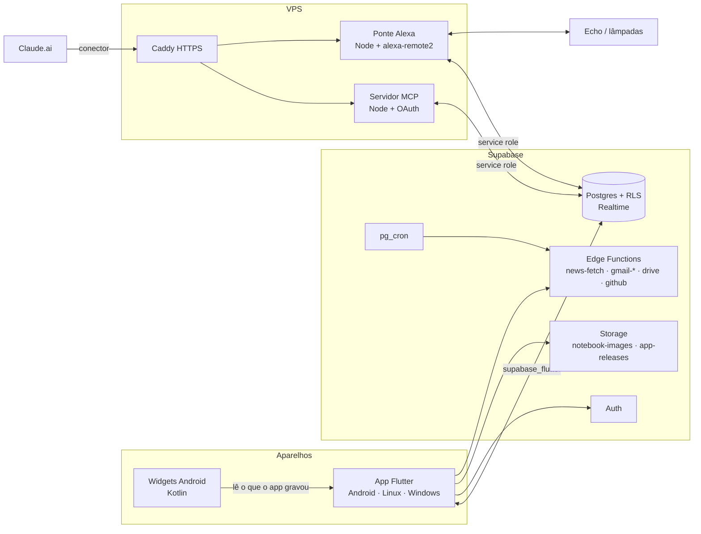

# Guia do desenvolvedor do Organize

Este guia explica como o app foi construído, como as partes se encaixam e como mudar o projeto:
acrescentar ou tirar funcionalidades e até rodar **sem servidor**. Ele descreve o código como está
no branch em que foi escrito (outubro de 2026). Se algo aqui divergir do código, vale o código, e o
guia deve ser corrigido.

Sumário:

1. [Visão geral](#1-visão-geral)
2. [Como o app foi construído](#2-como-o-app-foi-construído)
3. [Mapa do repositório](#3-mapa-do-repositório)
4. [Arquitetura do app Flutter](#4-arquitetura-do-app-flutter)
5. [O servidor: Supabase, ponte da Alexa e MCP](#5-o-servidor-supabase-ponte-da-alexa-e-mcp)
6. [Ambiente de desenvolvimento, testes e builds](#6-ambiente-de-desenvolvimento-testes-e-builds)
7. [Receita: acrescentar uma funcionalidade](#7-receita-acrescentar-uma-funcionalidade)
8. [Receita: tirar uma funcionalidade](#8-receita-tirar-uma-funcionalidade)
9. [Rodar sem servidor (modo local)](#9-rodar-sem-servidor-modo-local)
10. [Outras modificações comuns](#10-outras-modificações-comuns)
11. [Armadilhas conhecidas](#11-armadilhas-conhecidas)

---

## 1. Visão geral

O Organize (pasta e pacote `organizacional`) junta agenda, tarefas, notas, cadernos com caneta,
notícias, e-mail, arquivos do Drive, issues do GitHub e a casa (Alexa) num app só. Ele roda em
**Android, Linux e Windows** com o mesmo código Flutter.

São quatro peças:



| Peça | Onde roda | Linguagem | Pasta |
|---|---|---|---|
| App | celular, PC | Dart/Flutter (+ Kotlin nos widgets e canais nativos) | `app/` |
| Banco, login, arquivos, funções | Supabase (nuvem) | SQL + TypeScript/Deno | `supabase/` |
| Ponte da Alexa | VPS (Docker) | TypeScript/Node | `bridge/` |
| Servidor MCP (Claude) | VPS (Docker) | TypeScript/Node | `mcp/` |

Todo o dado do usuário fica no Postgres do Supabase e é protegido por **RLS** (cada linha tem
`user_id` e só o dono lê e escreve). O app fala direto com o banco. A ponte e o MCP usam a chave
`service_role` e **sempre** filtram por `user_id`.

---

## 2. Como o app foi construído

O projeto foi feito em fases, cada uma com **spec** (o que e por quê) e **plano** (passos com
checkbox), escritos antes do código e guardados em `docs/superpowers/`:

| Fase | Spec / plano | O que entregou |
|---|---|---|
| 1. Fundação | `plans/2026-09-28-organizacional-fase1-fundacao.md` | schema + RLS, Flutter, espaços, notas com `[[links]]`, tarefas, Hoje, agenda semanal |
| 2. Notícias | `plans/…-fase2-noticias.md` | parser RSS/Atom (Deno), `news-fetch` + cron, filtro por interesses |
| 3. Alexa | `plans/…-fase3-alexa.md` | ponte na VPS, despertares, skill "Organize", tela Casa |
| Visual (sub-projeto A) | `plans/2026-10-11-subprojeto-a-visual.md` | 10 temas, Kanban, calendário, editor rico, quadro de avisos |
| Widgets Android | `plans/2026-10-11-widgets-android.md`, `…widget-agenda-e-icone.md` | 4 widgets, ícone que segue o tema |
| MCP | `plans/2026-10-12-mcp-claude.md` | o Claude lê e altera os dados (27 ferramentas) |
| Despertar inteligente | `plans/2026-10-12-despertar-*.md` | parar música, clima, "só em casa", dispositivos |
| Séries, GitHub, Drive, Gmail | `plans/2026-10-12-series-alarmes-github-drive.md`, `…drive-local-e-pastas.md` | eventos repetidos, issues, Drive, e-mail |
| Caderno (S Pen) | `plans/2026-10-13-caderno-fase1.md`, `…-14-caderno-fase2.md` | tinta com pressão, sincronização com merge, reconhecimento, corretor, gestos |
| Atualização | migração `20261027000000_app_releases.sql`, `tool/release.sh` | botão "Atualizar" dentro do app |

O jeito de trabalhar, que vale manter:

- **Spec → plano → TDD.** Cada task do plano começa pelos testes falhando. O plano lista os
  arquivos, a API e as regras ("Global Constraints"), e só depois vem o código.
- **Tudo testável sem servidor.** Cada acesso a dados passa por uma interface com versão
  *Memory* (testes) e *Supabase* (produção). Por isso a suíte do app roda sem rede.
- **Commits por fase**, com mensagem em pt-BR dizendo o que mudou e por quê.
- **Interface e mensagens em pt-BR**, fuso `America/Sao_Paulo` nos testes.

---

## 3. Mapa do repositório

```
app/                      app Flutter
  lib/
    main.dart             liga tudo: Supabase, providers de produção, rotas, widgets
    app/                  casca: app.dart (tema), router.dart (rotas), shell.dart (navegação), providers.dart
    domain/               modelos e regras puras (sem Flutter de UI): Note, TaskItem, CalendarEvent, …
    data/                 interfaces de repositório + implementações Memory* e Supabase*
    features/<tela>/      uma pasta por área: agenda, tasks, notes, today, news, home (Casa), settings, …
    notebook/             Caderno: core/ (tinta pura), data/, state/ (controller), ui/, intelligence/
    ui/                   temas (themes.dart gerado), widgets visuais comuns, tokens (org_theme.dart)
    widgets/              widgets da tela inicial do Android (lado Dart)
    location/             GPS e relatório de localização (despertar "só em casa")
    update/               atualização por dentro do app
    files/                cache e abertura de arquivos do Drive
    app_icon/             ícone que muda com o tema (Android)
  android/                projeto Android (Kotlin dos widgets, canais, manifesto)
  linux/ windows/         runners de desktop
  test/                   espelha lib/ (1.800+ testes)
  tool/                   geradores: gen_themes.dart, gen_app_icons.dart
  assets/                 fontes embutidas (Sora, Inter, Fira Code, Caveat)
supabase/
  migrations/             o schema inteiro, em ordem de data (nunca edite uma já publicada)
  tests/database/         testes pgTAP (RLS, checks, gatilhos)
  functions/              Edge Functions (Deno): news-fetch, gmail-*, drive, github, _shared/
bridge/                   ponte da Alexa (Node): agendador de despertares, comandos, skill
mcp/                      servidor MCP (Node): OAuth de usuário único + ferramentas
docs/superpowers/         specs e planos de cada fase
tool/release.sh           publica uma versão (APK + Linux + Windows) para o botão "Atualizar"
scripts/                  gravam segredos do Google e do GitHub no Supabase
.github/workflows/        builds do Windows e do Android no GitHub Actions
```

---

## 4. Arquitetura do app Flutter

### 4.1 Camadas

```
features/ (telas)  →  providers (Riverpod)  →  data/ (interfaces)  →  Supabase | Memory
        ↘                                       ↗
           domain/ (modelos e regras puras)
```

- **`domain/`**: classes imutáveis com `fromMap`/`toMap` e regras puras, como `agenda.dart` (monta
  o dia), `recurrence.dart` (séries), `wikilinks.dart` (`[[links]]`) e `system_notices.dart`
  (avisos do sistema). Não importa Supabase.
- **`data/`**: para cada fonte de dados há uma **interface** e duas implementações:

  | Interface | Memory (testes) | Supabase (produção) |
  |---|---|---|
  | `Repository` (espaços, notas, tarefas, eventos, etiquetas, avisos) | `memory_repository.dart` | `supabase_repository.dart` |
  | `NewsRepository` | `memory_news_repository.dart` | `supabase_news_repository.dart` |
  | `AlexaRepository` | `memory_alexa_repository.dart` | `supabase_alexa_repository.dart` |
  | `SettingsRepository` | `memory_settings_repository.dart` | `supabase_settings_repository.dart` |
  | `LocationRepository` | `memory_location_repository.dart` | `supabase_location_repository.dart` |
  | `EmailRepository` | `memory_email_repository.dart` | `supabase_email_repository.dart` |
  | `DriveRepository` | `memory_drive_repository.dart` | `supabase_drive_repository.dart` |
  | `GithubRepository` | `memory_github_repository.dart` | `supabase_github_repository.dart` |
  | `NotebookRepository` (Caderno) | `notebook/data/memory_notebook_repository.dart` | `notebook/data/supabase_notebook_repository.dart` |
  | `ReleaseRepository` (atualização) | (falso nos testes) | `update/release_repository.dart` |

- **Providers (Riverpod 3)**: cada repositório tem um provider que **lança erro por padrão**
  (`throw UnimplementedError('… precisa de override')`). O `main.dart` sobrescreve com a versão
  Supabase, e os testes com a Memory (`test/helpers.dart` → `pumpApp`). Os dados chegam às telas
  por `StreamProvider`/`FutureProvider` (`spacesProvider`, `notesProvider`, `tasksProvider`,
  `eventsFromProvider`, `newsFeedProvider`…).
- **`features/`**: telas e diálogos. Elas só conhecem providers e `domain/`, nunca o Supabase.

> **O ponto de troca é o `main.dart`.** Ali, numa lista de `overrides`, cada interface recebe a
> implementação de produção. Trocar o backend inteiro, ou desligar uma funcionalidade, começa
> nessa lista.

### 4.2 Tempo real e offline

- `SupabaseRepository._watch` usa `.stream(primaryKey: ['id'])`, o Realtime do Supabase. Cada
  tabela que a tela observa precisa estar em `supabase_realtime`: a migração faz
  `alter publication supabase_realtime add table …`.
- As notas salvam com *debounce* e guardam um rascunho em memória se a gravação falhar
  (`NoteDrafts`).
- O **Caderno** tem fila offline própria (`notebook/state/notebook_pending_store.dart`, em
  `shared_preferences`), versão otimista com **merge** de páginas (union por id menos
  *tombstones*) e envio na abertura do app (`notebookStartupSyncProvider`). Leia
  `app/lib/notebook/core/README.md` antes de mexer na tinta.

### 4.3 Rotas e navegação

- `app/router.dart` (go_router): `/login`, o Caderno em tela cheia (`/caderno/:id`) e uma
  `ShellRoute` com `/`, `/agenda`, `/tarefas`, `/notas`, `/nota/:id`, `/espacos/:id`, `/noticias`,
  `/casa`, `/casa/despertar/:id`, `/documentos`, `/github`, `/ajustes`, `/mais`.
- O `redirect` manda para `/login` quem não tem sessão (`isSignedIn`).
- `app/shell.dart` define a navegação: `_sidebarItems` (barra lateral, largura ≥ 720) e
  `_bottomItems` (celular: Início, Agenda, Tarefas, Notas, Mais). "Mais" (`features/more/`) lista
  o que não cabe embaixo.

### 4.4 Visual

- 10 temas escuros gerados de `docs/superpowers/specs/assets/themes-10.json` por
  `dart run tool/gen_themes.dart` → `lib/ui/themes.dart`. `org_theme.dart` transforma o tema em
  `ThemeData` + `OrgTokens` (`context.org.accent`, `.ink`, `.inkMuted`, `.surfaceRaised`…).
  **Use sempre os tokens, nunca cores fixas.**
- Fontes: Sora, Inter e Fira Code embutidas (`assets/google_fonts/`); as outras o `google_fonts`
  baixa na primeira vez. Caveat (`assets/fonts/`) é a letra manuscrita do Caderno.

### 4.5 Recursos nativos e de plataforma

| Recurso | Dart | Nativo |
|---|---|---|
| Widgets da tela inicial | `lib/widgets/` (gera `w_*` com `home_widget`, atualiza em segundo plano com `workmanager`) | `android/…/widgets/*.kt` |
| Ícone por tema | `lib/app_icon/` (canal `dev.organizacional/app_icon`) | 10 `activity-alias` no manifesto |
| Compartilhar de outros apps | `features/import/`, `data/share_intent_service.dart` | intent-filter no manifesto |
| Localização ("só em casa") | `lib/location/` (geolocator + permission_handler) | permissões no manifesto |
| Escrita à mão | `notebook/intelligence/mlkit_recognizer.dart` (ML Kit), `spell_checker.dart` (corretor do Android) | plugin |
| Arquivos do Drive | `lib/files/` (cache + abrir com o app do sistema) | Android: canal; Linux: `xdg-open`; Windows: `url.dll` |
| Atualização | `lib/update/` (baixa, confere sha256, instala) | Android: instalador do sistema; desktop: troca a pasta |

Tudo que é de plataforma tem uma implementação **Noop** usada nos testes e nas plataformas sem o
recurso. O `main.dart` escolhe a implementação por plataforma (`isAndroid`, `Platform.isLinux`…).

---

## 5. O servidor: Supabase, ponte da Alexa e MCP

### 5.1 Banco (Supabase/Postgres)

O schema inteiro está em `supabase/migrations/`, aplicado em ordem:

| Migração | Tabelas / o que faz |
|---|---|
| `…0928_core_schema` | `spaces`, `notes`, `tasks`, `events` + gatilho `touch_updated_at` |
| `…0929_news`, `…_news_cron` | `news_sources`, `news_subscriptions`, `news_prefs`, `news_items`, função `news_feed`, cron de 20 em 20 min |
| `…0930_alexa` | `wake_plans`, `wake_runs`, `alexa_commands`, `alexa_devices`, `alexa_routines`, `alexa_bridge_status`, RPC `claim_wake_run` |
| `…1011_ui_redesign` | `user_settings` (tema etc.), `notices` (quadro de avisos) |
| `…1012_wake_music_stop`, `…1013_smart_wake`, `…1018_wake_overrides` | ajustes do despertar, `user_locations`, exceções por data |
| `…1014_task_priority`, `…1017_event_series`, `…1026_event_tags` | prioridade, séries de eventos, etiquetas |
| `…1016_gmail`, `…1021_gmail_modify`, `…1019_google_drive`, `…1020_oauth_nonce` | Google: contas, e-mail, Drive, proteção do OAuth |
| `…1022_imported_files` | arquivos importados pelo "compartilhar" |
| `…1023_notebooks`, `…1024_notebook_prefs`, `…1025_spaces_keep_notebooks` | Caderno: `note_pages`, bucket `notebook-images`, favoritos |
| `…1027_app_releases` | versões publicadas + bucket privado `app-releases` |

O padrão de **toda** tabela do usuário:

```sql
create table public.minha_tabela (
  id uuid primary key default gen_random_uuid(),
  user_id uuid not null default auth.uid() references auth.users (id) on delete cascade,
  …
);
alter table public.minha_tabela enable row level security;
revoke all on public.minha_tabela from anon;
create policy "dono" on public.minha_tabela for all to authenticated
  using (user_id = (select auth.uid()))
  with check (user_id = (select auth.uid()));
alter publication supabase_realtime add table public.minha_tabela;  -- se a tela observa
```

Cada migração tem o seu teste pgTAP em `supabase/tests/database/`: outro usuário não lê nem
escreve, os checks recusam valores inválidos e os gatilhos fazem o que devem.

### 5.2 Edge Functions (`supabase/functions/`, Deno)

| Função | Para quê | Chamada por |
|---|---|---|
| `news-fetch` | busca os feeds RSS/Atom, valida feed novo | `pg_cron` (20 min) e o app (`refreshNow`, `validate`) |
| `gmail-connect`, `gmail-callback`, `gmail-sync`, `gmail-action`, `gmail-disconnect` | OAuth do Google e e-mails (somente leitura + marcar como lido) | app; `gmail-sync` também pelo cron (10 min) |
| `drive` | listar, enviar, baixar, mover arquivos do Google Drive | app |
| `github` | listar e criar issues | app |

As funções guardam os segredos (`GOOGLE_CLIENT_SECRET`, `GITHUB_TOKEN`, `CRON_SECRET`) nos
segredos do Supabase. **O app nunca vê essas chaves.** Os passos de configuração estão em
`supabase/functions/*_SETUP.md`.

### 5.3 Ponte da Alexa (`bridge/`)

Processo Node na VPS (Docker + Caddy) que:

- mantém a sessão da conta Amazon (`alexa-remote2`, login em `src/scripts/login.ts`);
- sincroniza Echos, rotinas e dispositivos para as tabelas `alexa_*`;
- executa a fila `alexa_commands` (`device`, `routine`, `speak`, `music`, `delete_device`, `sync`,
  `wake_test` em `src/commands.ts`);
- dispara os despertares (`scheduler.ts` + `wake.ts`), com clima (`weather.ts`), presença
  (`presence.ts`) e alarme reserva no Echo;
- atende a skill oficial "Organize" (`skill.ts`, modelo em `bridge/skill/`).

Detalhes de implantação estão no README, seção "Alexa".

### 5.4 Servidor MCP (`mcp/`)

Servidor do Model Context Protocol com OAuth de **usuário único** (senha definida por
`set-passphrase`). As ferramentas estão em `mcp/src/tools/` (`agenda.ts`, `tasks.ts`, `notes.ts`,
`notices.ts`, `news.ts`, `wake.ts`, `alexa.ts`, `study.ts`), registradas em `tools/index.ts`.
Cada uma filtra por `ctx.userId`. Veja `mcp/README.md`.

---

## 6. Ambiente de desenvolvimento, testes e builds

```bash
# App
cd app
flutter pub get
flutter analyze                                        # precisa sair "No issues found!"
TZ=America/Sao_Paulo flutter test --exclude-tags integration
flutter run -d linux --dart-define-from-file=env.json  # env.json: SUPABASE_URL e SUPABASE_ANON_KEY (opcionais: DRIVE_ACCOUNT e GMAIL_ACCOUNT, a conta sugerida no login do Google)

# Banco local (precisa do Docker)
npx supabase start
npx supabase migration up --local
npx supabase test db                                   # pgTAP

# Edge Functions
deno test supabase/functions/

# Ponte e MCP
cd bridge && npx vitest run && npx tsc -p tsconfig.typecheck.json
cd mcp    && npx vitest run && npx tsc -p tsconfig.typecheck.json
```

Builds e publicação:

| O quê | Como |
|---|---|
| Versão para o botão "Atualizar" (APK + Linux, e Windows com `--windows`) | `tool/release.sh "novidades" [--windows] [--minor]` no computador que tem a chave de assinatura |
| Versão do Android para o botão "Atualizar", sem o computador de casa | Suba o `+N` do `app/pubspec.yaml` e rode GitHub Actions → "Publicar atualização" (precisa dos segredos `ENV_JSON`, `ANDROID_KEYSTORE_B64` e `SUPABASE_SERVICE_ROLE_KEY`) |
| Windows avulso | GitHub Actions → "App Windows" (tag `windows-v*` ou Run workflow) |
| Android avulso / checagem de PR | GitHub Actions → "App Android" (PRs que mexem em `app/**`, tag `android-v*`). Com o segredo `ANDROID_KEYSTORE_B64`, o APK atualiza o app instalado |

O APK é assinado com `~/.android/debug.keystore` (ver `android/app/build.gradle.kts`). **Guarde
uma cópia dessa chave fora do computador**: sem ela, o celular não aceita atualizações e é preciso
desinstalar o app.

---

## 7. Receita: acrescentar uma funcionalidade

Exemplo completo: um registro de **Hábitos** (nome + dias marcados). Os mesmos passos valem para
qualquer dado novo.

### Passo 1: modelo em `domain/`

`app/lib/domain/habit.dart`:

```dart
class Habit {
  const Habit({required this.id, required this.name, this.doneDays = const []});
  final String id;
  final String name;
  final List<DateTime> doneDays;

  factory Habit.fromMap(Map<String, dynamic> m) => Habit(
        id: m['id'] as String,
        name: m['name'] as String,
        doneDays: [for (final d in (m['done_days'] as List? ?? const [])) DateTime.parse(d as String)],
      );

  Map<String, dynamic> toMap() => {
        'id': id,
        'name': name,
        'done_days': [for (final d in doneDays) d.toIso8601String().substring(0, 10)],
      };
}
```

Teste em `test/domain/habit_test.dart` (ida e volta do `toMap`/`fromMap`).

### Passo 2: tabela + RLS + teste pgTAP

`supabase/migrations/<data>_habits.sql`, com data **depois** da última migração:

```sql
create table public.habits (
  id uuid primary key default gen_random_uuid(),
  user_id uuid not null default auth.uid() references auth.users (id) on delete cascade,
  name text not null check (char_length(name) between 1 and 60),
  done_days date[] not null default '{}',
  created_at timestamptz not null default now()
);
alter table public.habits enable row level security;
revoke all on public.habits from anon;
create policy "dono" on public.habits for all to authenticated
  using (user_id = (select auth.uid())) with check (user_id = (select auth.uid()));
alter publication supabase_realtime add table public.habits;
```

`supabase/tests/database/habits_test.sql`: copie o padrão de `core_test.sql` (dois usuários,
`set local role authenticated`, B não lê nem altera os hábitos de A). Rode
`npx supabase migration up --local && npx supabase test db`.

### Passo 3: interface + Memory + Supabase em `data/`

```dart
// data/habit_repository.dart
abstract interface class HabitRepository {
  Stream<List<Habit>> watchHabits();
  Future<void> upsertHabit(Habit h);
  Future<void> deleteHabit(String id);
}
```

- `memory_habit_repository.dart`: um `Map<String, Habit>` + `StreamController.broadcast`. Copie o
  `_watch`/`_write` do `MemoryRepository`.
- `supabase_habit_repository.dart`: `_db.from('habits').stream(primaryKey: ['id'])`, `upsert` e
  `delete`, com o mesmo `_guard`, que traduz `PostgrestException` em `RepositoryException`.

### Passo 4: providers

Em `app/providers.dart` (ou num `habit_providers.dart` da própria feature):

```dart
final habitRepositoryProvider = Provider<HabitRepository>(
  (ref) => throw UnimplementedError('habitRepositoryProvider precisa de override'),
);
final habitsProvider = StreamProvider<List<Habit>>((ref) => ref.watch(habitRepositoryProvider).watchHabits());
```

Ligue a versão de produção no `main.dart`:

```dart
habitRepositoryProvider.overrideWithValue(SupabaseHabitRepository(client)),
```

E a de teste no `test/helpers.dart` (`pumpApp`), com um parâmetro opcional
`HabitRepository? habits` → `habits ?? MemoryHabitRepository()`.

### Passo 5: tela, rota e navegação

1. `features/habits/habits_screen.dart`: `ConsumerWidget` que lê `habitsProvider`. Use os
   componentes de `ui/` (`PageHeader`, `OrgCard`, `EmptyHint`) e as cores de `context.org`.
2. Rota em `app/router.dart`, dentro da `ShellRoute`:
   `GoRoute(path: '/habitos', builder: (_, _) => const HabitsScreen())`.
3. Navegação em `app/shell.dart`: crie
   `const _habitos = (path: '/habitos', icon: Icons.repeat, label: 'Hábitos');`, acrescente em
   `_sidebarItems` e trate o prefixo em `_activePath`. No celular, ponha um item na tela "Mais"
   (`features/more/more_screen.dart`) em vez de lotar a barra inferior.
4. Se fizer sentido, um cartão no Início (`features/today/dashboard_cards.dart`).

### Passo 6: testes de tela

`test/features/habits_test.dart` com `pumpApp(tester, repo, location: '/habitos', …)`: criar,
marcar o dia, apagar, erro de gravação mostrando aviso. Rode `flutter analyze` e a suíte.

### Passo 7 (opcional): o Claude e a Alexa

- **MCP**: crie `mcp/src/tools/habits.ts` com `server.registerTool('list_habits', …)`, consultando
  `habits` com `.eq('user_id', ctx.userId)`, e registre em `tools/index.ts`. Testes em
  `mcp/test/tools.test.ts`.
- **Alexa / resumo do dia**: acrescente uma linha em `bridge/src/briefing.ts`.

### Checklist

- [ ] modelo + teste
- [ ] migração com RLS + pgTAP
- [ ] interface + Memory + Supabase
- [ ] provider com override no `main.dart` e no `test/helpers.dart`
- [ ] tela + rota + navegação + testes
- [ ] `flutter analyze` limpo e suíte verde
- [ ] `npx supabase db push` (nuvem) só depois de testar no local

---

## 8. Receita: tirar uma funcionalidade

Tirar é o caminho inverso, mas **não apague migrações antigas**: o histórico do banco já as
aplicou. Para remover tabelas, crie uma migração nova com `drop table …`. Ou deixe as tabelas
paradas, que não custam nada.

| Funcionalidade | O que tirar no app | No servidor |
|---|---|---|
| **Notícias** | `features/news/`, rota `/noticias`, `_noticias` em `shell.dart`, cartão de manchetes em `features/today/`, `newsRepositoryProvider` no `main.dart` | cron `news-fetch` (`select cron.unschedule('news-fetch')`), função `news-fetch` |
| **Casa / Alexa / despertares** | `features/home/`, rotas `/casa*`, `_casa` no shell, `alexaRepositoryProvider`, card "Minha casa" (`features/settings/home_location_card.dart`), `lib/location/` e o registro em segundo plano no `main.dart` | parar a ponte (`docker compose down` em `bridge/`); ferramentas `wake.ts` e `alexa.ts` no MCP |
| **E-mail (Gmail)** | `features/email/`, `gmail_card.dart`, `emailRepositoryProvider` | funções `gmail-*`, cron `gmail-sync` |
| **Drive / Documentos** | `features/documents/`, `drive_card.dart`, `downloaded_files_card.dart`, `lib/files/`, `driveRepositoryProvider`, `filesPlatformProvider` | função `drive` |
| **GitHub** | `features/github/`, rota `/github`, `githubRepositoryProvider` | função `github`, segredo `GITHUB_TOKEN` |
| **Caderno** | `lib/notebook/`, rota `/caderno/:id`, criação em `features/notes/notebooks/`, providers do caderno no `main.dart`, `notebookStartupSyncProvider` | bucket `notebook-images`, tabela `note_pages` |
| **Widgets Android** | `lib/widgets/`, `widgetSinkProvider`, registro em segundo plano, `widgets_card.dart` | Kotlin em `android/…/widgets/` e os `<receiver>` do manifesto |
| **Ícone por tema** | `lib/app_icon/` + override | `activity-alias` do manifesto (deixe um só com LAUNCHER) |
| **Atualização interna** | `lib/update/`, overrides no `main.dart`, o `UpdateBanner` | bucket `app-releases`; não use mais o `tool/release.sh` |
| **Claude (MCP)** | nada no app | parar o serviço `mcp` |

Depois de tirar:

1. Rode `flutter analyze`. Ele aponta todo import e provider que sobrou.
2. Apague ou ajuste os testes das telas removidas (pasta espelho em `test/`).
3. Procure o nome da funcionalidade no código (`grep -rn "noticias\|newsFeedProvider" app/lib`)
   para achar cartões e atalhos esquecidos, como os do Início e os avisos do sistema
   (`domain/system_notices.dart`).
4. Rode a suíte inteira.

---

## 9. Rodar sem servidor (modo local)

Hoje o app depende do Supabase para quatro coisas: **login**, **guardar os dados**, **sincronizar
entre aparelhos** e **funções que exigem segredo ou execução contínua** (notícias, Google, GitHub,
Alexa, MCP). Há três caminhos, do mais simples ao mais completo.

### Caminho A: tudo no aparelho, sem conta (um aparelho só)

A arquitetura já ajuda: as telas só conhecem as interfaces de `data/`. Basta dar a elas uma
implementação que grava em disco.

**1. Repositório local.** O `MemoryRepository` (em `lib/data/`, não em `test/`) já implementa
tudo em memória, inclusive as regras do banco, como títulos únicos e espaços que, ao serem
apagados, deixam os cadernos. Falta só persistir. O jeito mais curto é um embrulho que recarrega
na abertura e regrava um JSON a cada mudança:

```dart
// lib/data/local_repository.dart
import 'dart:async';
import 'dart:convert';
import 'dart:io';

import 'memory_repository.dart';
// + imports dos modelos (Space, Note, TaskItem, CalendarEvent, Notice, EventTag)

/// Repositório só do aparelho: o MemoryRepository, salvo num arquivo JSON.
class LocalRepository extends MemoryRepository {
  LocalRepository(this.file);
  final File file;
  final _subs = <StreamSubscription>[];
  Map<String, Object?> _snapshot = {};
  Timer? _debounce;

  Future<void> open() async {
    if (await file.exists()) {
      final j = jsonDecode(await file.readAsString()) as Map<String, dynamic>;
      for (final m in (j['spaces'] as List? ?? [])) { await upsertSpace(Space.fromMap(m)); }
      for (final m in (j['notes'] as List? ?? [])) { await upsertNote(Note.fromMap(m)); }
      for (final m in (j['tasks'] as List? ?? [])) { await upsertTask(TaskItem.fromMap(m)); }
      for (final m in (j['events'] as List? ?? [])) { await upsertEvent(CalendarEvent.fromMap(m)); }
      for (final m in (j['tags'] as List? ?? [])) { await upsertTag(EventTag.fromMap(m)); }
      for (final m in (j['notices'] as List? ?? [])) { await upsertNotice(Notice.fromMap(m)); }
    }
    void keep(String key, Stream<List<dynamic>> s) =>
        _subs.add(s.listen((list) { _snapshot[key] = [for (final x in list) x.toMap()]; _save(); }));
    keep('spaces', watchSpaces());
    keep('notes', watchNotes());
    keep('tasks', watchTasks());
    keep('events', watchEvents(from: DateTime(1970)));
    keep('tags', watchTags());
    keep('notices', watchNotices());
  }

  void _save() {
    _debounce?.cancel();
    _debounce = Timer(const Duration(milliseconds: 400), () async {
      final tmp = File('${file.path}.tmp');
      await tmp.writeAsString(jsonEncode(_snapshot));
      await tmp.rename(file.path); // troca atômica: nunca deixa o arquivo pela metade
    });
  }
}
```

Esse caminho serve bem até milhares de itens. Para muito mais, troque o JSON por SQLite
(`sqflite` no Android e `sqflite_common_ffi` no desktop, ou `drift`) mantendo a mesma interface.
Nenhuma tela precisa mudar.

Os outros repositórios seguem a mesma ideia: `MemorySettingsRepository`,
`MemoryNotebookRepository` (o Caderno já tem fila offline e merge; o local só precisa gravar
`note_pages` e as imagens numa pasta) e `MemoryLocationRepository`.

**2. `main.dart` sem Supabase.** Troque o começo por algo assim:

```dart
final dir = await getApplicationSupportDirectory();          // pacote path_provider
final repo = LocalRepository(File('${dir.path}/organize.json'));
await repo.open();
final router = buildRouter(isSignedIn: () => true);          // sem tela de login
runApp(ProviderScope(overrides: [
  repositoryProvider.overrideWithValue(repo),
  settingsRepositoryProvider.overrideWithValue(LocalSettingsRepository(...)),
  notebookRepositoryProvider.overrideWithValue(LocalNotebookRepository(...)),
  notebookImageStoreFactoryProvider.overrideWithValue((noteId) => LocalImageStore(dir, noteId)),
  // as funcionalidades que dependem de servidor: tire (seção 8) ou use as versões abaixo
], child: OrganizacionalApp(router: router)));
```

**3. O que fazer com cada funcionalidade que precisa de servidor:**

| Funcionalidade | Sem servidor |
|---|---|
| Notícias | Leve o parser de `supabase/functions/news-fetch/` (Deno/TS) para Dart e busque os feeds no próprio app com `http`. No celular e no PC não há CORS. O filtro por interesses/bloqueios é a função SQL `news_feed`, que vira uma função Dart. Sem cron: busca ao abrir a tela |
| Gmail, Drive | O OAuth do Google exige um segredo que hoje fica nas Edge Functions. Sem servidor, use o fluxo de **app instalado** (PKCE, sem segredo) com um cliente OAuth do tipo Android/Desktop e chame as APIs do Google direto do app. É trabalhoso; o mais simples é tirar (seção 8) |
| GitHub | Um token pessoal do usuário guardado no aparelho (`flutter_secure_storage`), com chamadas à API REST do GitHub direto do app |
| Alexa e despertares | Precisam de um processo sempre ligado com a sessão da Amazon. Sem VPS, rode a ponte no seu PC (`cd bridge && docker compose up`), mas aí ela precisa de um banco para ler os despertares, então volta-se ao caminho B. Senão, tire |
| Claude (MCP) | É um servidor por definição (o claude.ai chama uma URL). Tire, ou rode localmente e use pelo Claude Desktop/Code com transporte stdio |
| Atualização interna | Aponte o `ReleaseRepository` para as Releases do GitHub (a API pública lista os arquivos) e mantenha o resto de `lib/update/` |
| Widgets e "só em casa" | Os widgets já leem o que o app grava (`home_widget`) e funcionam sem servidor. O relatório de localização só existe para a ponte: tire junto com a Alexa |
| Busca no texto do Caderno | Já é local: o reconhecimento (ML Kit) roda no aparelho |

A desvantagem do caminho A é que **cada aparelho tem os próprios dados**. Para usar no celular e
no PC, veja os caminhos B e C.

### Caminho B: o mesmo app, com o Supabase no seu computador (self-host)

Nenhuma linha do app muda. O Supabase é de código aberto e roda em Docker:

1. Num PC ou mini-servidor sempre ligado: `npx supabase start` serve para testes. Para uso
   contínuo, siga o guia oficial de self-hosting do Supabase (docker-compose).
2. Aplique o schema: `npx supabase db push --db-url postgres://…` (ou `migration up`).
3. Publique as funções (`npx supabase functions serve` ou o runtime `edge-runtime` do compose) e
   configure o `pg_cron` com a URL local (o README explica os segredos do Vault).
4. Gere o `env.json` com a URL e a chave anon do seu servidor e compile o app.

Você mantém login, tempo real e sincronização, sem depender da nuvem do Supabase. A ponte e o MCP
apontam para esse servidor (`SUPABASE_URL` no `.env`).

### Caminho C: local com sincronização por arquivo

Uma variação do caminho A: o `LocalRepository` grava o JSON numa pasta sincronizada (Syncthing,
Drive para desktop, Nextcloud). Para não perder edições feitas em dois aparelhos ao mesmo tempo,
grave um arquivo **por aparelho** e mescle na leitura: união por `id`, vencendo o `updated_at`
mais novo, com tombstones para exclusões. É o mesmo princípio do merge do Caderno
(`PageDoc.merge`). Dá para fazer, mas é a opção com mais detalhes para acertar.

### Resumo de decisão

| Você quer… | Caminho |
|---|---|
| Só um aparelho, nada de servidor | A |
| Vários aparelhos, sem a nuvem do Supabase | B |
| Vários aparelhos, sem servidor algum | C (mais trabalhoso) |
| Alexa e Claude | precisam de um processo ligado: A não serve; use B, ou mantenha a VPS |

---

## 10. Outras modificações comuns

- **Mudar ou criar tema**: edite `docs/superpowers/specs/assets/themes-10.json` (tokens, fontes,
  glifo, motivo), rode `dart run tool/gen_themes.dart` e, para o ícone no Android,
  `dart run tool/gen_app_icons.dart`. Ids novos entram em `themeIds` (`domain/user_settings.dart`),
  no check da coluna `theme` (migração nova) e nos `activity-alias` do manifesto.
- **Novo widget Android**: siga `docs/superpowers/specs/2026-10-11-widgets-android-design.md` (o
  contrato `w_*`). Crie o provider Kotlin reaproveitando `BaseOrgWidget.kt`/`WidgetData.kt`, o
  layout, o `<receiver>` e acrescente o nome em `widgetProviderNames` (`lib/widgets/widget_sink.dart`).
- **Nova ferramenta do Claude**: `mcp/src/tools/<área>.ts` + `index.ts`. Use `ok()`/`fail()` de
  `util.ts`, valide com zod e filtre por `ctx.userId`.
- **Novo comando da Alexa**: um `case` em `bridge/src/commands.ts`, o tipo aceito no check de
  `alexa_commands.kind` (migração nova) e o envio no `AlexaRepository` do app.
- **Nova fonte de notícias no catálogo**: `supabase/functions/news-fetch/` (catálogo e
  `check_feeds.ts` para validar).
- **Trocar o nome ou o ícone do app**: `android:label` no manifesto, `linux/`
  (`APPLICATION_ID`/título), `windows/runner/` e os ícones gerados.
- **PDF no Caderno** (`lib/notebook/pdf/`): na importação, cada página do PDF é renderizada
  (pdfrx/PDFium, `PdfrxRasterizer`) em JPEG de 2000 px, enviada ao bucket `notebook-images` e
  vira uma página do caderno com um `ImageBox(background: true)` (no JSON, `"bg": true`). O fundo
  fica sempre por baixo e o laço e a borracha não o pegam. Não há leitor de PDF na hora de abrir:
  sincronização, cache e modo offline são os mesmos das imagens. Na web e nos testes o provider é
  `NoopPdfRasterizer` e a opção some. Para trocar o leitor, implemente `PdfRasterizer` e faça o
  override de `pdfRasterizerProvider` no `main.dart`. Para mudar a resolução ou o limite de
  páginas, altere `kPdfRenderWidth` e `kMaxPdfPages`.
- **Notas do caderno** (`lib/notebook/linked_notes.dart`, `linked_notes_ui.dart`,
  `domain/notebook_linked_note.dart`): cada caderno tem no máximo uma nota de texto vinculada,
  "Notas — <caderno>", na mesma pasta. O vínculo é `linkedNoteId` no JSON do `body` do caderno
  (convive com `cover` e `pdf`). O trecho do PDF (citação + "p. N · dd/MM") e a escrita convertida
  ("Enviar para as notas do caderno" no laço) são **acrescentados ao fim** da nota. As notas não
  têm merge, então `LinkedNotes` relê a nota mais recente do repositório antes de cada gravação
  (sem resposta em 4 s, usa o cache de `notesProvider`). A nota mostra o link "Abrir o caderno"
  procurando o caderno cujo `body` aponta para ela (`notebookLinkedTo`).
- **"Melhorar escrita"** (`lib/notebook/intelligence/straighten.dart`): os ajustes de cada linha
  ficam nas constantes do topo do arquivo: inclinação mínima e máxima corrigida, faixa de
  altura-x na pauta e tolerância do alinhamento à esquerda. As pautas vêm de `ruleGuideFor`, que
  usa `kLinedTop`/`kRuleSpacing` de `core/ink_types.dart`, as mesmas constantes que o fundo
  desenha. Se mudar o desenho das pautas, mude essas constantes, e o encaixe acompanha.

---

## 11. Armadilhas conhecidas

- **`TextBox` do Caderno colide com o `TextBox` do Flutter.** Em arquivos que importam
  `material.dart`, use `import 'package:flutter/material.dart' hide TextBox;`.
- **Caderno: editar = apagar + criar com id novo.** Nunca altere um traço "no lugar"; guarde os
  ids da seleção pelo `idMap` (`*Mapped`). Operações por página usam o **id** da página, nunca o
  índice.
- **Migrações publicadas não se editam.** Sempre uma nova, com data maior.
- **RLS em toda tabela nova**, inclusive `revoke all … from anon`. Na ponte e no MCP (service
  role), todo `select`/`update`/`delete` filtra por `user_id`.
- **Testes com fuso**: rode com `TZ=America/Sao_Paulo`, porque vários testes dependem da virada do
  dia.
- **Build do APK**: o número de build (`+N` no `pubspec`) precisa ficar abaixo de 1000 (o
  `versionCode` por ABI é `1000·ABI + N`) e sempre subir. Um build menor que o instalado não
  instala.
- **Assinatura**: APK assinado com outra chave não atualiza o app ("App not installed").
- **Windows** só compila no GitHub Actions (o Flutter não faz build de Windows a partir do Linux).
- **Fontes nos testes**: o `flutter test` desenha texto sem a fonte real. Para conferir o visual,
  carregue as fontes com `FontLoader` e gere imagens com `matchesGoldenFile` (`--update-goldens`).
- **Segredos**: `app/env.json`, `bridge/.env` e a chave de assinatura nunca vão para o git (veja o
  `.gitignore`). Se o repositório ficar público, só o que está nos segredos do GitHub e do
  Supabase continua privado.
